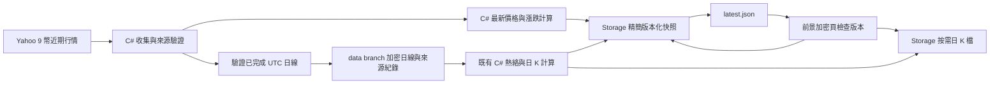

# 筆記 #90：加密貨幣半小時更新實作方案

日期：2026-10-23。狀態：**程式與本機驗證完成；正式首輪與網站發布驗證進行中，48 小時／換日／週末觀察待完成。**

本文件供其他模型直接接手。目標是讓加密貨幣全年無休、以每 30 分鐘收集一次為目標更新行情，同時控制 Supabase 流量；價格與完整日線指標分開標示時間。接手時仍須重新閱讀最新 `AGENTS.md`、`Doc/`、`README.md`、`Doc/TODO.md` 與實際程式，以最新 main 為基礎。使用者後續已明確授權本 Session 實作、更新文件、commit、push 與網站發布；第 1～13 節保留需求契約，第 14 節記錄實際實作／部署證據。

## 1. 需求、範圍與完成定義

筆記 #90 標題為「【加密貨幣】更新速度」：加密市場 24 小時運作，網站資料應盡快更新；使用者偏好方案 2「每半小時或較長間隔更新，Supabase 流量不能大幅增加」，並認可本次提出的實作方向。

### 1.1 第一版契約

| 項目 | 定案行為 |
|---|---|
| 收集週期 | 每 30 分鐘一次，24/7，週末及台股休市照常執行；可設定為 60 分鐘，但第一版預設 30 |
| 名冊 | 沿用 `MarketOverviewCatalog.Crypto` 的 9 幣：BTC、ETH、SOL、DOGE、BNB、XRP、ADA、AVAX、LINK，USD 報價 |
| 主要卡片 | 沿用 BTC、ETH、SOL 三張，不新增主卡 |
| 半小時更新 | 最新價格、當日漲跌百分比／USD 金額、今年漲跌百分比／USD 金額、9 幣熱圖的漲跌顏色及列表數值 |
| 每日更新 | 完整 UTC 日線、既有熱絡分數、20 日平均成交額資金關注度權重、完整日 K；週末也補齊 |
| 網站讀取 | Supabase Storage 的精簡公開快照；每 5 分鐘檢查小指標，版本變動才下載完整快照 |
| 畫面時間 | 行情使用來源報價時間；熱絡、權重及日 K 使用各自完整日線日期；不可只顯示網站產生時間 |
| 延遲提示 | 行情最舊來源時間超過 90 分鐘，保留有效資料並明顯提示延遲 |
| 更新路徑 | 日常快照不依賴全站 export／Pages 發布、不新增行情 REST 查詢、Edge Function 或 Realtime 訂閱 |

完成必須同時涵蓋收集、日線保存、C# 計算、Storage 發布、manifest、前端更新、K 線按需載入、測試與正式驗證；只有新增 cron 或成功上傳一份 JSON 不算完成。

### 1.2 本輪排除

不新增交易所／付費來源、全市場幣種榜、市值／BTC 主導率／賽道分類、資產頁加密估值、當日暫估熱絡分數、盤中 K 線、下單或買賣訊號。不改台股／美股／日韓現有更新頻率、公式、權限與 OCR Worker。行情來源先沿用 Yahoo；來源既有無 SLA 與公開展示限制不因改用 CDN 而消失。

## 2. 調查基準、證據與替代方案

### 2.1 接手基準

| 項目 | 2026-10-23 查核結果 |
|---|---|
| Repository | `qwe953751/Investment` |
| 本機 HEAD、origin/main、實際遠端 main | `704d2ad4f41ca936ca435139d8391100f2392622` |
| 本機狀態 | detached HEAD；新增本文件前工作區乾淨 |
| 正式網站 | `https://frank-invest.github.io/` |
| 執行要求 | `net10.0`；`global.json` 基準 SDK 10.0.302、`latestFeature` |

以上是調查快照，不是接手時必然狀態。不得未確認就切換分支或覆蓋其他 session 的變更。

### 2.2 已查明的原因

- `.github/workflows/us-daily-snapshot.yml` 在平日排程中執行 `backfill-overview --markets us,crypto`，再觸發全站純發布。加密目前受美股回補與網站發布時序限制。
- `MarketOverviewDownloader.AppendToBuffer` 主動排除未完成的 UTC 當日 K。因此增加既有 backfill 次數仍無法取得本需求的最新價格。
- `StaticSiteExporter.WriteMarketOverviewAsync` 產生 `data/market-overview.json`；前端 `ensureMarketOverviewData()` 成功後在該頁生命週期內直接使用記憶體資料，不會自行取得新的加密快照。
- 日韓已有版本化 Storage 快照，但 collector、交易日曆、檔名驗證、CDN 探測、前端與過期門檻都限定日韓。不能只把 `crypto` 加進陣列就完成。
- [熱絡指標 §6.2](熱絡指標.md#62-加密貨幣)要求只使用完整 UTC 日線；本案保留此規則。最新價與已完成日線指標必須使用不同時間欄位。

2026-10-23 唯讀抽測：Yahoo `BTC-USD` 的 `range=5d&interval=1d` 已包含當天形成中的價格，時區為 UTC，回應約 1.6 KB；`1d/5m` 約 8.7 KB。網站當時的加密 `asOf` 為 `2026-10-21`，加密區塊約 1,043 bytes（本機 gzip 約 475 bytes）。這只驗證 BTC 與當次回應；其他 8 幣、來源 timestamp 的語意與跨日穩定性仍須於實作驗證，不把一次成功視為供應保證。

### 2.3 替代方案

| 方案 | 優點 | 不選為第一版的原因 |
|---|---|---|
| 跟著台股／美股發布 | 改動最少 | 假日與夜間更新不足，仍是完整日線，無法達成 #90 |
| 每半小時跑全站回補及發布 | 可沿用現有指令 | 重抓兩年、多市場耦合、反覆輸出大量靜態檔，且未完成日 K 仍被排除 |
| 每台瀏覽器直連 Yahoo 或 Supabase DB | 初期接線短 | 裝置數放大來源請求與流量，時間及計算口徑難集中 |
| 獨立 C# collector＋小型 Storage 快照 | 重用既有來源、公式與發布模式，資料量小 | **採用**；需完整處理日線基準、快照一致性及載入生命週期 |

## 3. 資料流與儲存邊界



半小時原始報價不寫 PostgreSQL，也不每輪 commit `data`。完整日線保存成功後才發布對應的新每日結果；盤後可追溯資料仍保存在 `data`，Storage 是公開讀取副本。9 幣名冊小，不需為本案使用 Supabase DB URL 或 Management API token。

### 3.1 完整日線獨立保存與相容讀取

建議新增 `data/imports-overview-crypto/` 作為加密完整日線的唯一新寫入目錄。既有 `imports-overview/YYYY-MM-DD.json` 是多市場共用檔，不能讓加密與美股／日韓同時改同一檔後僅靠 `git rebase` 碰運氣。

1. 新 reader 組合既有資料與加密專用目錄；同日同幣重複時，新目錄經驗證的列優先，其他市場資料不受影響。每日完整快照仍保有明確 symbol／UTC 日期與來源。
2. 初次從既有有效歷史建立新目錄，必要時補足兩年。只加入缺日／缺幣，不刪除或搬走舊檔、不改既有行情；保存來源回應或可核對的來源紀錄、雜湊與下載時間。
3. 原始來源回應與正規化完整日線分開保存：來源原文若保存就保留原 bytes 與雜湊，不裁切後冒稱原文；計算用日線只納入已完成 UTC 日期。原文中的當日形成中 K 不得混進完整日線。來源後續修訂與既存值不同時，保留新觀測及差異，不自動覆寫已保存的歷史結果。
4. 新 reader 與初次資料驗證通過後，美股 workflow 改成 `--markets us`；所有仍可呼叫 `backfill-overview --markets crypto` 的入口必須導向同一個新 store／寫入規則，避免兩套加密寫入者。
5. exporter、熱絡計算與加密 K 線都要讀到同一組合後歷史；不能只讓新 collector 看到新日線，而靜態回退仍停在舊資料。
6. `data` push 遇到其他市場同時新增不同檔案時可受控 rebase 重試；同一加密日線若內容衝突，讀取遠端後按 symbol／日期重新核對，不以整檔覆蓋解衝突。不允許 force push 或行情刪除。

## 4. 日期、計算與來源契約

### 4.1 最新行情

採 UTC 日界線，台北 08:00 換日。來源先以短視窗日線 chart 為候選，例如 `range=5d&interval=1d`；實作時先驗證 9 幣。使用最新價格及其真正來源時間，不把日 K 的午夜 timestamp 當作最新報價時間，也不把 HTTP 下載完成時間當來源時間。

- `sourceAt` 必須能證明與該筆價格相符；若使用 meta 的 `regularMarketPrice/regularMarketTime`，價格與時間必須成對。不可用 meta 新時間搭配陣列中的舊 close。
- 每輪須有 9 個不重複且符合名冊的有效正價格。建議新快照門檻：來源年齡最多 15 分鐘、幣間來源時間差最多 10 分鐘、未來時鐘容忍最多 2 分鐘；設為可測設定，9 幣實測不符時記錄證據再調整，不能直接移除新鮮度檢查。
- 收集跨 UTC 午夜時，以各筆來源時間驗證共同日期；若跨日，重新取得必要列或放棄本輪，不混合兩日基準。不得沿用日韓週末／休市守衛。
- 新輪缺任一幣、核心欄位無效、429 或來源過舊：不更新行情 latest，保留上一份完整快照。來源限流時本輪停止後續請求；一般暫時錯誤只做有上限退避，不無限重試。

### 4.2 當日與今年漲跌

所有數值由 C# 算好，百分比沿用既有 decimal 與顯示精度規則。

```text
當日基準 = 最新行情 UTC 日期的前一日完整收盤
當日漲跌 USD = 最新價 − 當日基準
當日漲跌 % = (最新價 / 當日基準 − 1) × 100
今年基準 = 既有 YearToDateChangePercent 的前一年 12 月最後有效收盤
今年漲跌 USD = 最新價 − 今年基準
今年漲跌 % = (最新價 / 今年基準 − 1) × 100
```

當日的前一日缺值時顯示 `null`，不能拿更早一日冒充當日漲跌；今年基準沿用現有規則並輸出實際基準日期，缺少前一年 12 月資料時顯示 `null`。零或負基準不得做除法。UTC 元旦要跟隨新報價年份換今年基準，不能跟著台北午夜提早換年。

現行前端會以現值與四捨五入後百分比反推絕對變動；本案新增的加密快照應直接提供 C# 的 USD 差額，前端優先顯示它，不因百分比四捨五入造成差額偏差。舊快照及其他市場仍可走既有相容路徑。

### 4.3 每日熱絡、權重與 K 線

- 完整日線日期必須嚴格早於現在 UTC 日期。每日區塊採 9 幣共同到齊日，保留既有至少 60 日預熱、兩年歷史、固定四幣權重與 EMA3 公式，不使用半小時價重算熱絡。
- 9 幣熱圖顏色使用本輪當日漲跌；面積／權重使用完整日線的 20 日平均成交額，標示「資金關注度」，並標明該日線日期。
- `QuoteTurnover` 的 Yahoo volume 在既有下載器作報價貨幣成交額使用。不能套用日韓 `close × 累計 volume`，也不能未核對就把五分鐘 volume 相加混入既有日線 OBV。來源單位不清楚時保留缺值並回報。
- K 線保留已完成日 K 與既有均線計算，不畫當天暫估 K。展開時顯示完整日線截至日期，避免與上方最新價混為一筆時間。
- 前一日尚未到齊時，行情仍可更新；每日區塊沿用已驗證結果與真實日期、顯示日線延遲，當日漲跌基準不足者顯示 `—`。不得把舊日線改標成昨天。

## 5. 每半小時流程與每日補齊

新增獨立 workflow，建議名稱 `crypto-market-snapshot.yml`，以一次短 job 完成一輪。一般輪次只對 9 幣各抓一次短視窗資料；同一回應可供最新行情與完整日線檢查，避免重複請求。

每輪依序：

1. checkout 目前 main 原始碼與最新 `data`；檢查 .NET 10、必要設定及 Storage 寫入秘密是否存在，只回報設定狀態。
2. 收集短視窗行情，驗證最新值、來源時間、名冊與限流狀態。
3. 檢查 `UTC today - 1` 以及歷史缺口。若每日基準已齊，不重抓兩年、不新增每日 commit；若有新完整日線，驗證後保存 `data`，再計算與發布新每日區塊。
4. 來源剛跨日尚未公布完整前日資料時，不睡數小時等待；記錄每日未到齊，下一個半小時輪次自然再檢查。中斷多日超出短視窗時，才做有範圍的補洞；不能默默跳過中間缺日。
5. 每日保存／計算失敗與行情發布分開記錄。可發布本輪有效價格加上一份已驗證的舊每日區塊，但必須標示延遲；不能發布尚未成功保存 `data` 的新每日結果。
6. 發布缺失或不一致時以非零狀態／job summary 回報；部分步驟成功不表示整體完成，不用 `continue-on-error` 把真正失敗洗成成功。

初次建立歷史可能較久，應有明確 bootstrap／補洞模式；一般收集不能因歷史補洞失敗失去仍可驗證的最新價，也不能把不完整歷史算成有效新分數。第一份行情快照若還沒有每日資料，可明確使用 `daily=null`，之後補齊；正式完成驗收仍要求每日路徑可正常工作。

### 5.1 排程設定與可靠性

- 初版可用每小時第 7、37 分鐘觸發，避開整點；排程全年所有星期，並提供手動單輪入口。這是建議 workflow 設定，不是在 Codex 建立 recurring automation。
- 使用獨立 concurrency group，`cancel-in-progress: false`，不占用或取消 `daily-snapshot`／`daily-snapshot-publish`／日韓的鎖。正式 prefix 只由此 workflow 寫入，手動維運也透過同一入口，維持單一發布者。
- 遲到的 run 收集當下資料，不回補多個過期半小時輪次。不要複製台股長時間 sleep／接力常駐來維持 24 小時 runner。
- GitHub schedule 是 best effort，可能延遲或漏發；30 分鐘是收集目標，不是最長延遲保證。延遲 UI 以來源時間自行判斷，即使整條 workflow 沒啟動也能顯示。
- job summary 記錄目標週期、最舊／最新來源時間、日線日期、成功／失敗階段、bytes、版本與 `data` commit。連續失敗保持可見，不把無資料變化的每輪當作使用者通知。
- 驗收收集至少 48 小時的實際間距及漏發，包含週末或補做週末觀察。若無法滿足使用者對更新時效的要求，下一步是另議可靠的外部排程觸發同一 workflow；不得宣稱加 cron 就已保證半小時更新。

## 6. Storage、資料契約與版本一致性

### 6.1 儲存布局

優先沿用現有公開 bucket `market-overview-intraday-snapshots`，只新增 `crypto/` prefix；建立加密專用 publisher／契約，重用可抽出的 HTTP 上傳元件。不要擴大日韓所有交易時段及前端分支。是否現有寫入秘密允許該 prefix，須於部署前核對，不把有環境變數當作有權限。

建議布局：

```text
crypto/latest.json
crypto/snapshots/{UTC時間含秒}-{每日日期與版本或none}-{內容雜湊}.json
crypto/daily/{完整日期}-{16字元版本雜湊}-{symbol}.json
```

完整行情快照以未壓縮 UTF-8 JSON **10 KB 以內**為驗收預算，latest **1 KB 以內**為上限、0.5 KB 為估算目標。半小時快照不夾帶 K 線陣列、歷史原文、其他市場、資產、筆記或使用者資料。

### 6.2 契約必要欄位

以下是新契約語意；名稱若調整，須同步文件、C#、JS 與測試，不借用日韓 `tradeDate=group.asOf` 規則掩蓋兩種時鐘。

| 位置 | 欄位／語意 |
|---|---|
| latest | `schemaVersion=1`、`market=crypto`、`file`、完整檔 `sha256`、`sourceAsOf`、`dailyAsOf`（可空） |
| 完整快照 | `schemaVersion`、`market`、`publishedAt`、`sourceAsOf`、`live`、`daily`、`warnings` |
| `sourceAsOf` | 本輪 9 幣真正來源時間的最小值，不能用 collector 執行時間代替 |
| `live` 每列 | `symbol`、名稱、USD 最新價、`sourceAt`、當日／今年的百分比與 USD 差額、各自實際基準日期；共 9 列 |
| `daily` | 可為空；否則含完整 `asOf`、已保存 `dataCommit`、BTC／ETH／SOL 個別熱絡、四幣綜合熱絡、9 幣資金關注度權重及按需 K 線索引 |
| K 線索引 | 每幣相對路徑、內容雜湊及完整 `asOf`；路徑與上述每日版本一致 |
| null／warning | 欄位缺值用 null，並有具體原因；不能用 0、模板、其他日期或剩餘幣重分配權重代替 |

latest 與完整快照的 schema、市場、來源時間、每日日期必須一致。前端驗證 JSON 前先驗證原始 bytes 的 SHA256；檔名只允許預定 `crypto/` 相對路徑，拒絕外部 URL、`..`、未知 schema、重複／額外幣種、非法日期及不符合名冊的列。

### 6.3 發布及清理

1. 先上傳每日 K 線資產並驗證可公開讀取（僅日線版本變更時）。
2. 再上傳完整版本化快照，確認 HTTP、bytes 與 hash 正確。
3. 最後更新 latest；不可讓指標先指向尚未存在的檔案。重試不得改寫同名不可變檔，使用內容雜湊避免同分鐘碰撞。
4. 發布與前端都拒絕來源時間倒退；應檢查每幣來源時間及每日日期，不只比較 `publishedAt`。相同行情但每日區塊前進可以產生新版本，不能被「價格沒變」去重掉。
5. latest 使用短 TTL（建議 60 秒內），不可變檔使用長 TTL。不要每次加時間戳或隨機 query 破壞快取；實測瀏覽器與 CDN headers，不能只看程式傳了 cache-control。
6. 保留最新 30 份行情快照；每日資產至少保留最近 7 組，且所有保留快照引用的資產不得先刪。只清理加密的精確 prefix，不刪 `latest.json`、日韓資料或 `data` 歷史。
7. 清理失敗獨立回報，不回滾已發布的有效指標；讀者取得剛被清理的舊路徑時，最多重新讀 latest 再試一次，不無限重試。

## 7. 前端與靜態匯出整合

### 7.1 manifest 與相容回退

manifest 新增加密專屬的可選 `cryptoOverviewCdn` 宣告，只包含公開 base URL、schema 與讀取所需設定。正式 Supabase URL 沿既有安全設定於執行時取得，不把值或任何金鑰寫入交接文件。

export 宣告前要實際讀取 `crypto/latest.json` 及完整快照並驗證契約／hash；不能因日韓有資料就宣告加密可用。沒有有效首份快照時不宣告，前端保留 `market-overview.json` 的舊完整日線回退並顯示真實日期。

靜態 `crypto` fallback 保持向後相容，從組合後歷史產生，不偷偷換成未完成當日 K。舊網站不認得新欄位仍能運作；新網站沒有宣告時也能正常顯示舊資料，不能顯示「即時」。首次啟用需先有快照再做一次 `publish-only=true`，之後半小時更新不重新 export／發布、不改 manifest 的網站版本。

### 7.2 載入與生命週期

- 初次進入加密面板立即檢查 latest；若沒有可用快照，顯示靜態日線並標註回退。靜態載入失敗不能阻擋可獨立成功的加密 CDN 載入。
- 只有加密行情面板可見且 `document.visibilityState === visible` 時，每 5 分鐘查指標。停在資產、筆記、其他市場、背景／鎖屏或離線時不輪詢。
- pointer 的版本／hash 相同時，完整快照下載次數為 0；變動才下載一次，驗證後整批提交。Promise 去重，不要只依賴完成後的結果快取。
- `visibilitychange`、`focus`、`pageshow`、`online` 合併觸發一次到期檢查；用牆上時間判斷，不在手機喚醒後補打一串 timer。短暫切換頁面不繞過節流，網路失敗也有退避上限。
- 同瀏覽器分頁使用既有 `BroadcastChannel`／leader 模式或等效的小型共用機制。租約到期可接手，不同市場不能爭同一筆加密輪詢租約；API 不可用時各頁仍只按 5 分鐘讀小檔。
- 使用載入序號或目前市場檢查，防止離開加密後才完成的回應把其他市場畫面蓋回去。快照可留在加密快取，但只有仍顯示加密時才重畫。
- CDN 暫時失敗時保留最後驗證快照與原始 sourceAt；無快取才回退靜態資料。不得改查資料庫、直連 Yahoo，或把 loadedAt 當成資料更新時間。
- 超過 90 分鐘警示由目前時間與來源時間計算，即使 pointer 不變或請求全失敗也會變舊；可以本機更新時間提示，但不增加網路請求。每日未更新使用另一個日期提示，不被新價格掩蓋。

### 7.3 顯示與 K 線

保留目前三張卡、熱圖／列表及權限布局，不加加密盤中／盤後切換器與交易日選擇器。行情時間用台北時間並註明 UTC 日界線；熱絡、權重與日 K 另顯示完整日期。最新值與靜態回退不可拼成一個沒有時間標記的 group。

展開 K 線才讀每日索引指向的 immutable 檔，依 hash 快取；維持 `market=CRYPTO` 與現有 raw-market-overview-daily 語意。切換日線版本時讓已展開圖表取得對應新版本，未展開不預抓 9 幣全套；K 線失敗不清空行情卡。日線透過 Storage 發布新 K 線，不能等下一次全站發布才讓週末 K 線更新。

## 8. 流量預算與量測

以完整快照 10 KB、latest 0.5 KB、30 台裝置每天 24 小時停在加密行情、每 5 分鐘檢查、每半小時有新版本、每月 30 天估算：

```text
每台每日 = 288 × 0.5 KB + 48 × 10 KB = 624 KB
30 台每月 = 624 KB × 30 × 30 = 561,600 KB ≈ 0.56 GB
```

這是主要 JSON body 的保守情境估算，不是帳單承諾。未包含 HTTP headers、TLS、重試、K 線按需下載、每日上傳驗證、Storage list／清理等流量；若 latest 實際達 1 KB，對應 body 約 0.69 GB／月。前景限制與分頁共用通常減少用量，須量測後才能下結論。

CDN 命中仍有 cached egress，未命中會有 uncached egress；不要把資料庫查詢下降說成 Supabase 總流量歸零，也不要用過時 quota 或「一定壓縮後計費」作保證。本案不新增 Edge 呼叫；Storage 大小、cached／uncached egress、API 錯誤與 Actions 執行時間都要另留量測。

## 9. 建議修改範圍與實作順序

類別名稱是建議，實作可依最新架構調整；不得把公式放進 Razor／JS。

| 工項 | 主要位置／責任 |
|---|---|
| A. 基準與來源驗證 | Overview 相關 client、catalog 與 source tests；9 幣 UTC、價格時間成對、日線 volume 語意 |
| B. 加密完整日線 store／reader | `Infrastructure/MarketData/Overview/`；獨立目錄、legacy 合併、增量補洞、保存來源及衝突處理 |
| C. 最新價格 projection | 新 `CryptoOverviewCollector`／`CryptoOverviewProjection`；基準日期、百分比／差額、每日與即時時間分流 |
| D. 發布器及日 K | 新加密 snapshot publisher，重用既有 HTTP 元件與 `DailyKLineCalculator`；不可變檔、hash、單調性、清理 |
| E. CLI 與 workflow | `Program.cs` 的 DI／參數／退出碼；新 workflow；美股 workflow 移除 crypto 寫入 |
| F. exporter 與設定 | `StaticSiteExporter.cs`、既有 appsettings 設定機制；組合歷史、專屬 CDN 健康探測與可選 manifest 欄位 |
| G. 前端 | `site.js` 加密專屬載入、版本快取、前景與分頁共用、實際資料時間、日 K 指標；僅必要 CSS |
| H. 文件與交付 | 本文件實作紀錄、README、TODO、完成進度、版本紀錄；區分本機通過／已部署／實際排程驗收 |

先做 A、B 與純計算測試，再做 C、D 的端到端契約，接 E～G，最後實際部署與觀察。不要先上線半小時 cron 再補來源驗證、去重或過期提示。

## 10. 驗收矩陣

以下使用可控 clock／HTTP fixture／隔離 prefix 等方式驗證行為；不要在正式資料上做破壞性故障注入。

| 類別 | 必測案例與期望 |
|---|---|
| 9 幣來源 | 正常完整；缺任一幣；重複／額外代號；零或負價格；429；過時 meta 搭新陣列及反向情況；不完整者不覆寫 latest |
| 時區 | 台北 07:59／08:00、UTC 午夜收集跨日、週末、台股休市、台北元旦與 UTC 元旦；日期及基準不混用 |
| 算術 | 最新價與前日收盤、年末基準的百分比與 USD 差額獨立核對；百分比四捨五入後不拿來反推金額；缺前日只空當日值 |
| 每日指標 | 同一 UTC 日內多輪最新價變化，完整日線 heat／weight／K 線不變；新完整日線到齊才前進；與舊 C# 公式逐欄一致 |
| 日線延遲 | 價格新但前日未公布、單幣量缺值、累積缺多日、每日保存失敗；標日期／warning，不產生假完整日線 |
| 相容與資料保存 | 新舊 store 重複日去重、既有行情不改、其他市場同日檔不動、舊靜態 fallback 正常；兩個 data push 競爭不掉列 |
| 發布順序 | K 線／完整檔上傳失敗、latest 寫入失敗、重試同秒、舊輪晚完成、相同價格但每日版本變更；不懸空、不倒退 |
| 契約 | hash／市場／日期／列數錯誤、路徑跳脫、未知 schema、未來 timestamp；前端拒絕並保留最後有效快取 |
| 流量 | 一小時內 pointer 不變時 full snapshot 0 次；兩個半小時新版本各最多 1 次／leader；半小時檔 ≤10 KB、latest ≤1 KB |
| 生命週期 | 切別市場／資產／筆記／背景不輪詢；離線與手機鎖屏恢復只補一輪；多分頁 leader 消失可接手；無 BC 可安全退化 |
| 競態 | 加密請求延遲完成時已切別市場，不覆蓋畫面；同 key 並發只有一筆下載；失敗後有冷卻不忙迴圈 |
| 過期與回退 | pointer 不變、CDN 斷線、整條 schedule 未執行超過 90 分鐘，都顯示延遲；恢復後自動更新；從不退回 DB／Yahoo |
| K 線 | 展開才下載、同版只抓一次、新每日版更新圖表、CRYPTO 標籤正確、只有完整日 K、404 重讀索引有界回復 |
| 清理 | 30 份行情與 7 組每日資產保留、引用資產不先刪、只處理 crypto prefix、清理失敗不回滾 |
| 跨市場回歸 | 台股排行／族群、美股、日韓盤中盤後及持倉頁現有讀取與切換無退化 |

### 10.1 指令與回報

在接手工作樹的 **repo 根目錄**執行。以下只列既有驗證指令，新 CLI 命令名稱與 dry-run 旗標須在實作後補入，不假裝目前已存在。

```sh
git status --short --branch
git log -1 --oneline
git ls-remote origin refs/heads/main
git diff --check
dotnet --version
node --version
```

用途：確認執行位置、版本與工作區。預期 SDK 為 10.x；不是 10.x 時先修正 PATH，不以 8／9 代跑。不得印環境變數值或帶 token 的 remote。

完成程式修改後，以 .NET 10 跑純計算、collector／publisher 與整合目標測試，再跑專案 Release 回歸及 Node 回歸：

```sh
dotnet test tests/Invest.Web.Tests/Invest.Web.Tests.csproj -c Release --logger 'console;verbosity=minimal'
node --test tests/*.test.mjs
git diff --check
git status --short --branch
```

Node glob 不一定涵蓋所有子目錄；仍須執行該次改動涉及的 workflow／CLI 腳本測試及專案既有其他必要檢查。先確認執行環境及依賴，不把缺依賴誤判為程式失敗；若使用 `--no-restore`，需先完成 restore。失敗時保留失敗測試名稱、第一個相關錯誤、SDK／Node 版本與執行位置，不貼 secrets、整包環境或敏感回應。

## 11. 正式部署順序與回復

1. 本機與隔離 prefix 完成測試、9 幣實際來源驗證與大小量測。依 `AGENTS.md` 檢查並更新接手文件，確認精確 Git 目標及該任務授權後，再提交／推送程式與 workflow 到 main。
2. 核對 Storage 寫入秘密與目標 bucket／prefix 的實際權限。不需 DB migration、不用 `SUPABASE_ACCESS_TOKEN` 發布一般行情；新權限問題必須明確回報，不放寬一般帳號 DDL 權限。
3. 透過新 workflow 執行 bootstrap／單輪，驗證 `data` 完整日線保存、K 線、完整快照、latest 與 hash；只在資料齊全時宣稱每日基準完成。不得以舊本機快取直接蓋正式網站。
4. 首份快照有效後，走既有 `daily-snapshot.yml --ref main -f trading-days=300 -f publish-only=true` 發布網站一次；核對 run success、headSha、正確 Pages repo、公開 manifest／site.js 與 crypto 宣告。純發布依設計不執行每日回補／DB 同步。
5. 在公開網站驗證三張卡與 9 幣列表、來源時間、熱絡日期、K 線與手機恢復；再等下一輪，確認 **網站 manifest 版本不變、crypto latest 前進、畫面自動更新**。至少觀察一個 UTC 換日與 48 小時輪距，補週末驗證。
6. 記錄 sourceAt→發布→畫面可見的延遲、每日基準延遲、實際 pointer／snapshot／K 線 bytes、快取行為、Supabase 用量及失敗次數。若 schedule 品質不符合需求，保留「已實作但排程時效未驗收」狀態。

故障回復優先保留最後有效快照；若需停用新路徑，停用精確的新 workflow，再透過正常程式／manifest 純發布回復完整日線顯示。恢復美股代抓 crypto 前先停掉新寫入者並核對 store 相容性，不讓兩個流程同時維護同日資料。不刪歷史、不手改 gh-pages、不清空整個共用 bucket。

## 12. 接手者交付清單與本輪狀態

接手者完成時回報：修改範圍、實際採用的 CLI／設定、測試結果、程式 commit、`data` commit、workflow run、公開網站版本、快照 hash／時間、48 小時與換日／週末觀察、實測 bytes／流量及仍未驗收項目。secret 只回報是否設定，不貼值。筆記 #90 不因文件完成就標為已完成。

最初規劃輪只新增本文件及 TODO 入口，當時未改程式或正式環境。後續使用者授權實作與發布，最新狀態以第 14 節為準；筆記 #90 狀態不因文件完成而改動。

規劃輪未修改已發布狀態；實作輪已同步 `完成進度.md`、`版本紀錄.md`、`TODO.md`，並明確區分本機完成與正式驗證。

## 13. 官方參考資料

- [GitHub Actions schedule 事件](https://docs.github.com/en/actions/reference/workflows-and-actions/events-that-trigger-workflows#schedule)：排程可能因高負載延遲或漏發，不是準時更新保證。
- [Supabase Egress 用量](https://supabase.com/docs/guides/platform/manage-your-usage/egress)：cached／uncached egress 分別計量，CDN 命中仍有流量。
- [Supabase Storage CDN](https://supabase.com/docs/guides/storage/cdn/fundamentals)：快取命中與回源機制；部署時仍須實測 cache headers。
- [現行熱絡指標](熱絡指標.md)：完整 UTC 日線、公式與成交量單位要求，本案不修改熱絡公式。

外部文件於 2026-10-23 查核；接手時核對最新官方說明。舊的 [Supabase 多裝置流量與盤中 CDN 決策](Supabase多裝置流量節流與盤中CDN決策.md)可借用快照模式，但其中舊網址、配額與歷史狀態不可直接當作目前部署事實。


## 14. 實作與驗證紀錄

### 14.1 程式與本機驗證（2026-10-23）

- 實作分支 `codex/crypto-half-hour`，基礎與當時遠端main皆為 `704d2ad4f`；保留並納入本 Session 原有交接文件。
- 新增 `CryptoOverviewClient`、`Collector`、`Projection`、`Publisher` 與明確 DTO；CLI `crypto-overview prepare ABS_DIRECTORY [--bootstrap]`、`crypto-overview publish ABS_DIRECTORY --data-commit SHA [--retain-daily]` 已存在。以上仍在repo根目錄，以.NET10執行。
- `prepare` 不需要Storage秘密，輸出 `stage.json` 及加密完整日線／原文；`publish` 缺Storage設定會非零結束。本機Storage秘密未設定，正式上傳交由repo既有GitHub secret執行；不取出或印出秘密。
- 原文按已完成日線的正規化內容hash去重，原始bytes另有metadata記錄其SHA256；meta最新價變化不會每半小時造成data提交。既存完整日線只增不改，後續來源修訂另保留觀測。
- 每日資產採平面版本檔名，方便只列精確prefix與保留引用；與第6節語意相同。行情檔名也含每日版本，使清理可保護仍被引用的舊日線而不反覆下載全部快照。
- 加密snapshot未含K線陣列，實測約5KB；日K以既有C# DailyKLineCalculator計算完整OHLC、MA5/10/20/60/240及原始volume，按需下載。
- 本機.NET Release 1026/1026、Node 407/407；加密C#16項與Node10項涵蓋來源完整性／過期、UTC換日／週末／元旦、基準缺值、數值精度、歷史穩定、原子發布／倒退、保存失敗續發有效價、清理保護、快取／前景／分頁／失敗退避／404有界重讀。
- 真實九幣來源抽查皆USD／UTC；bootstrap後本機777個完整日期、截至10/22。10/23T09:47:00Z行情之36個漲跌欄位獨立Decimal核對通過。這是本機調查證據，不代表正式環境已更新。
- workflow YAML、內嵌shell／Python與JS語法檢查通過。原main的兩項市場結構測試DOM缺事件介面已隔離重現，只修fixture，不改正式市場結構行為。

### 14.2 正式首輪與發布

進行中；需回填main程式commit、data commit、加密workflow run、純發布／Pages run、公開manifest版本、快照與資產hash、實際瀏覽器結果。正式完成前不宣稱已更新網站。

### 14.3 持續觀察

48小時排程間距、跨UTC換日、週末收集、實體手機背景恢復及Supabase計費用量尚待觀察。已驗證的單輪／模擬時鐘測試不能代替這些實地結果；若schedule時效不符需求，仍須另議外部觸發，不能把cron成功註冊當作準時保證。
